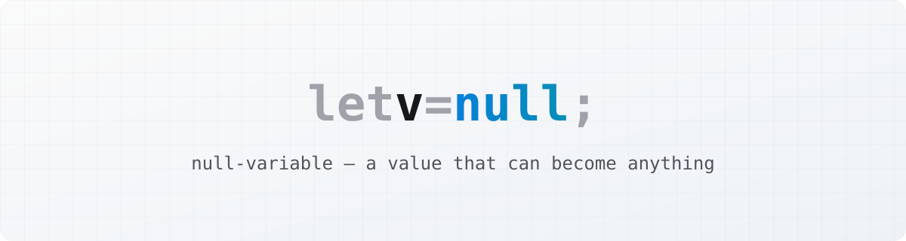

  <picture>
    <source media="(prefers-color-scheme: dark)" srcset="https://raw.githubusercontent.com/null-variable/.github/main/profile/banner-dark.svg">
    <source media="(prefers-color-scheme: light)" srcset="https://raw.githubusercontent.com/null-variable/.github/main/profile/banner-light.svg">
    
  </picture>

  <h3>私たちは、どんな値にもなれる <code>null-variable</code> です。</h3>

  

    <a href="https://github.com/null-variable">English</a> ·
    <a href="https://github.com/null-variable/.github/blob/main/profile/README.ko.md">한국어</a> ·
    <a href="https://github.com/null-variable/.github/blob/main/profile/README.zh-CN.md">简体中文</a> ·
    <b>日本語</b>
  

---

## 私たちについて

`null` で宣言された変数には、まだ型も値もありません。だからこそ、何にでもなれます。
null-variable も同じです。ひとつの分野や技術スタックに縛られず、課題を選び、それに合ったツールを選んで、自分たちが本番環境で使いたいと思えるオープンソースソフトウェアを作ります。

**私たちの作り方**

- **正しさが最優先**：最適化の前に、テスト、golden ファイル、fuzzing で動作を固定します。
- **巧妙さより明示性**：読みやすく素直なコードと、ドキュメント化されたコンポーネント間の契約を重視します。
- **原則オープン**：コード、設計ドキュメント、議論は OSI 承認ライセンスのもとで公開します。

## プロジェクト

| プロジェクト | 概要 | リポジトリ | 状態 |
|---|---|---|---|
| **[Proxelo](#proxelo)** | API と Web UI で管理する Web サーバー、リバースプロキシ、ロードバランサー | [`proxelo`](https://github.com/null-variable/proxelo) · [`proxelo-proxy`](https://github.com/null-variable/proxelo-proxy) · [`proxelo-api`](https://github.com/null-variable/proxelo-api) | 開発初期 |

今後も新しいプロジェクトを準備しています。この Organization を Watch するか、[すべてのリポジトリ](https://github.com/orgs/null-variable/repositories)をご覧ください。

### Proxelo

nginx のルーティングの意味をそのまま引き継ぎ、設定ファイルの代わりに API を使い、変更は適用前にシミュレーションで検証します。

| リポジトリ | 言語 | 役割 |
|---|---|---|
| [`proxelo`](https://github.com/null-variable/proxelo) | Go | コントロールプレーン：REST API、Web UI、SQLite、ACME、スナップショットコンパイラ |
| [`proxelo-proxy`](https://github.com/null-variable/proxelo-proxy) | Rust | データプレーン：有効なスナップショットで HTTP/1.1、HTTP/2、TLS、プロキシを処理 |
| [`proxelo-api`](https://github.com/null-variable/proxelo-api) | Protobuf | 両プロセスが共有するスナップショットと配信のプロトコル |

主な機能

- **nginx のセマンティクス、設定ファイル不要**：サイトとルートは nginx の `server_name` と `location` の順序に従い、`rewrite`、`try_files`、`error_page`、`log_format` に対応します。
- **リロードではなくリビジョン**：すべての変更はリビジョンにコンパイルされ、プロキシエンジンで dry-load できた場合のみ保存されます。`POST /api/v1/simulate` で、適用前にリクエストの行き先を確認できます。
- **止まらない配信**：コントロールプレーンが停止しても、プロキシは last-known-good スナップショットでトラフィックを処理し続けます。
- **アロケーションのないリクエスト経路**：データプレーンは `unsafe` を使わず、ウォーム接続ではリクエストごとのアロケーションがゼロであることをテストで保証し、コーデックは fuzzing しています。
- **運用機能を内蔵**：ACME による自動発行・更新（HTTP-01、TLS-ALPN-01）、round robin・least_conn・パッシブヘルスチェック、CEL によるルート条件、Prometheus メトリクス。

## コントリビュート

- バグや提案は各リポジトリの Issues で受け付けています。始める前に [CONTRIBUTING](https://github.com/null-variable/.github/blob/main/CONTRIBUTING.ja.md) をお読みください。
- セキュリティ上の脆弱性は公開 issue ではなく、[SECURITY](https://github.com/null-variable/.github/blob/main/SECURITY.ja.md) の手順で非公開に報告してください。
- Issue と PR は English、한국어、中文、日本語 のいずれでも歓迎します。

  Owner · <a href="https://github.com/th-release">cth.release</a>

