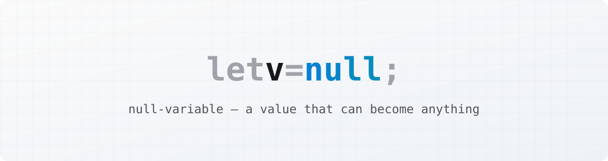

  <picture>
    <source media="(prefers-color-scheme: dark)" srcset="https://raw.githubusercontent.com/null-variable/.github/main/profile/banner-dark.svg">
    <source media="(prefers-color-scheme: light)" srcset="https://raw.githubusercontent.com/null-variable/.github/main/profile/banner-light.svg">
    
  </picture>

  <h3>저희는 어떤 값으로도 바뀔 수 있는 <code>null-variable</code> 입니다.</h3>

  

    <a href="https://github.com/null-variable">English</a> ·
    <b>한국어</b> ·
    <a href="https://github.com/null-variable/.github/blob/main/profile/README.zh-CN.md">简体中文</a> ·
    <a href="https://github.com/null-variable/.github/blob/main/profile/README.ja.md">日本語</a>
  

---

## 소개

`null`로 선언된 변수에는 아직 타입도 값도 없습니다. 그래서 무엇이든 될 수 있습니다.
null-variable도 마찬가지입니다. 하나의 분야나 기술 스택에 묶이지 않고, 문제를 고르고, 그 문제에 맞는 도구를 골라, 우리가 직접 운영 환경에서 쓸 만한 오픈소스 소프트웨어를 만듭니다.

**만드는 방식**

- **정확성 먼저**: 최적화하기 전에 테스트, golden 파일, fuzzing으로 동작을 고정합니다.
- **영리함보다 명시성**: 읽기 쉬운 평범한 코드와, 문서로 남긴 컴포넌트 간 계약을 선호합니다.
- **기본은 공개**: 코드, 설계 문서, 논의를 OSI 승인 라이선스로 공개합니다.

## 프로젝트

| 프로젝트 | 설명 | 저장소 | 상태 |
|---|---|---|---|
| **[Proxelo](#proxelo)** | API와 웹 UI로 관리하는 웹 서버, 리버스 프록시, 로드 밸런서 | [`proxelo`](https://github.com/null-variable/proxelo) · [`proxelo-proxy`](https://github.com/null-variable/proxelo-proxy) · [`proxelo-api`](https://github.com/null-variable/proxelo-api) | 초기 개발 |

더 많은 프로젝트를 준비하고 있습니다. 이 조직을 Watch하거나 [전체 저장소](https://github.com/orgs/null-variable/repositories)를 둘러보세요.

### Proxelo

nginx의 라우팅 의미를 그대로 가져오고, 설정은 파일 대신 API로 다루며, 적용 전에 시뮬레이션으로 검증합니다.

| 저장소 | 언어 | 역할 |
|---|---|---|
| [`proxelo`](https://github.com/null-variable/proxelo) | Go | 컨트롤 플레인: REST API, 웹 UI, SQLite, ACME, 스냅샷 컴파일러 |
| [`proxelo-proxy`](https://github.com/null-variable/proxelo-proxy) | Rust | 데이터 플레인: 활성 스냅샷으로 HTTP/1.1, HTTP/2, TLS, 프록시 처리 |
| [`proxelo-api`](https://github.com/null-variable/proxelo-api) | Protobuf | 두 프로세스가 공유하는 스냅샷·배포 프로토콜 |

주요 기능

- **nginx 규칙, 설정 파일 없음**: 사이트와 라우트는 nginx의 `server_name`·`location` 순서를 따르고, `rewrite`, `try_files`, `error_page`, `log_format`을 지원합니다.
- **리로드 대신 리비전**: 모든 변경은 리비전으로 컴파일되고, 프록시 엔진으로 dry-load한 뒤에만 저장됩니다. `POST /api/v1/simulate`로 요청이 어디로 가는지 적용 전에 확인할 수 있습니다.
- **멈추지 않는 서빙**: 컨트롤 플레인이 내려가도 프록시는 last-known-good 스냅샷으로 트래픽을 계속 처리합니다.
- **할당 없는 요청 경로**: 데이터 플레인은 `unsafe`를 쓰지 않고, warm 커넥션에서 요청당 할당 0을 테스트로 강제하며, 코덱은 fuzzing합니다.
- **운영 기능 내장**: ACME 자동 발급·갱신(HTTP-01, TLS-ALPN-01), round robin·least_conn·passive health, CEL 라우트 조건, Prometheus 메트릭.

## 기여

- 버그와 제안은 각 저장소의 Issues로 받습니다. 시작 전에 [CONTRIBUTING](https://github.com/null-variable/.github/blob/main/CONTRIBUTING.ko.md)을 읽어 주세요.
- 보안 취약점은 공개 이슈 대신 [SECURITY](https://github.com/null-variable/.github/blob/main/SECURITY.ko.md)의 절차로 알려 주세요.
- Issue와 PR은 English, 한국어, 中文, 日本語 모두 환영합니다.

  Owner · <a href="https://github.com/th-release">cth.release</a>

