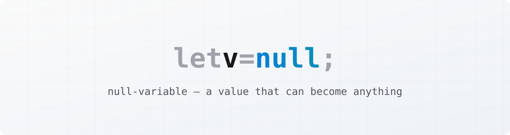
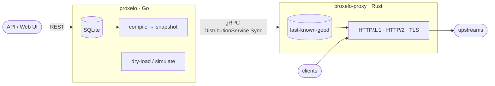

  <picture>
    <source media="(prefers-color-scheme: dark)" srcset="https://raw.githubusercontent.com/null-variable/.github/main/profile/banner-dark.svg">
    <source media="(prefers-color-scheme: light)" srcset="https://raw.githubusercontent.com/null-variable/.github/main/profile/banner-light.svg">
    
  </picture>

  <h3>We are <code>null-variable</code>: a variable that can become any value.</h3>

  

    <b>English</b> ·
    <a href="https://github.com/null-variable/.github/blob/main/profile/README.ko.md">한국어</a> ·
    <a href="https://github.com/null-variable/.github/blob/main/profile/README.zh-CN.md">简体中文</a> ·
    <a href="https://github.com/null-variable/.github/blob/main/profile/README.ja.md">日本語</a>
  

---

## About

A variable declared as `null` has no type or value yet. It can become anything.
null-variable is an open source organization that works the same way: we do not limit ourselves to one domain or one stack. We pick a problem, choose the tools that fit it, and build open source software we would run in production ourselves.

**How we build**

- **Correctness first**: behavior is pinned by tests, golden files and fuzzing before it is optimized.
- **Explicit over clever**: boring, readable code and documented contracts between components.
- **Open by default**: code, design documents and discussions happen in public, under OSI-approved licenses.

## Projects

| Project | What it is | Repositories | Status |
|---|---|---|---|
| **[Proxelo](#proxelo)** | Web server, reverse proxy and load balancer managed through an API and a web UI | [`proxelo`](https://github.com/null-variable/proxelo) · [`proxelo-proxy`](https://github.com/null-variable/proxelo-proxy) · [`proxelo-api`](https://github.com/null-variable/proxelo-api) | Early development |

More projects are on the way. Watch this organization or browse [all repositories](https://github.com/orgs/null-variable/repositories).

### Proxelo

Proxelo keeps nginx routing semantics, replaces config files with an API, and simulates every change before it goes live.

| Repository | Language | Role | CI |
|---|---|---|---|
| [`proxelo`](https://github.com/null-variable/proxelo) | Go | Control plane: REST API, web UI, SQLite, ACME, snapshot compiler |  |
| [`proxelo-proxy`](https://github.com/null-variable/proxelo-proxy) | Rust | Data plane: HTTP/1.1, HTTP/2, TLS, proxying from the active snapshot |  |
| [`proxelo-api`](https://github.com/null-variable/proxelo-api) | Protobuf | Snapshot and distribution protocol shared by both |  |

Architecture and features

- **nginx semantics, no config files**: sites and routes follow nginx `server_name` and `location` order, with `rewrite`, `try_files`, `error_page` and `log_format`.
- **Revisions, not reloads**: every change compiles into a revision and is stored only after the proxy engine dry-loads it. `POST /api/v1/simulate` shows where a request will go before you apply.
- **Keeps serving**: when the control plane is down, the proxy keeps serving its last-known-good snapshot.
- **Zero-alloc hot path**: no `unsafe` in the data plane, zero allocations per request on a warm connection (enforced by a test), and fuzzed codecs.
- **Built-in operations**: ACME issuance and renewal (HTTP-01, TLS-ALPN-01), round robin, least_conn and passive health, CEL route conditions, Prometheus metrics.

## Contributing

- Report bugs and ideas in each repository's Issues. Read [CONTRIBUTING](https://github.com/null-variable/.github/blob/main/CONTRIBUTING.md) before you start.
- Report security vulnerabilities privately as described in [SECURITY](https://github.com/null-variable/.github/blob/main/SECURITY.md), not in public issues.
- Issues and pull requests are welcome in English, 한국어, 中文 or 日本語.

  Owner · <a href="https://github.com/th-release">cth.release</a>

