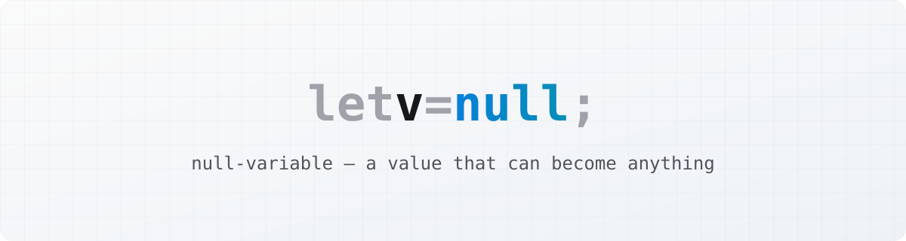

  <picture>
    <source media="(prefers-color-scheme: dark)" srcset="https://raw.githubusercontent.com/null-variable/.github/main/profile/banner-dark.svg">
    <source media="(prefers-color-scheme: light)" srcset="https://raw.githubusercontent.com/null-variable/.github/main/profile/banner-light.svg">
    
  </picture>

  <h3>我们是 <code>null-variable</code>：一个可以变成任何值的变量。</h3>

  

    <a href="https://github.com/null-variable">English</a> ·
    <a href="https://github.com/null-variable/.github/blob/main/profile/README.ko.md">한국어</a> ·
    <b>简体中文</b> ·
    <a href="https://github.com/null-variable/.github/blob/main/profile/README.ja.md">日本語</a>
  

---

## 关于我们

声明为 `null` 的变量还没有类型，也没有值，所以它可以成为任何东西。
null-variable 也是如此：我们不局限于某一个领域或技术栈。我们选定问题，挑选适合它的工具，构建我们自己也愿意在生产环境中运行的开源软件。

**我们的构建方式**

- **正确性优先**：在优化之前，先用测试、golden 文件和 fuzzing 固定行为。
- **明确胜于取巧**：偏好朴素易读的代码，以及有文档记录的组件间契约。
- **默认公开**：代码、设计文档和讨论都在公开环境中进行，并采用 OSI 认可的许可证。

## 项目

| 项目 | 简介 | 仓库 | 状态 |
|---|---|---|---|
| **[Proxelo](#proxelo)** | 通过 API 和 Web UI 管理的 Web 服务器、反向代理和负载均衡器 | [`proxelo`](https://github.com/null-variable/proxelo) · [`proxelo-proxy`](https://github.com/null-variable/proxelo-proxy) · [`proxelo-api`](https://github.com/null-variable/proxelo-api) | 早期开发 |

更多项目正在筹备中。欢迎关注本组织，或浏览[全部仓库](https://github.com/orgs/null-variable/repositories)。

### Proxelo

Proxelo 保留 nginx 的路由语义，用 API 取代配置文件，并在每次变更生效前进行模拟验证。

| 仓库 | 语言 | 职责 |
|---|---|---|
| [`proxelo`](https://github.com/null-variable/proxelo) | Go | 控制平面：REST API、Web UI、SQLite、ACME、快照编译器 |
| [`proxelo-proxy`](https://github.com/null-variable/proxelo-proxy) | Rust | 数据平面：基于当前快照处理 HTTP/1.1、HTTP/2、TLS 和代理 |
| [`proxelo-api`](https://github.com/null-variable/proxelo-api) | Protobuf | 两个进程共享的快照与分发协议 |

主要特性

- **nginx 语义，无需配置文件**：站点和路由遵循 nginx 的 `server_name` 与 `location` 匹配顺序，支持 `rewrite`、`try_files`、`error_page` 和 `log_format`。
- **以修订版本代替重载**：每次变更都会编译为一个修订版本，并且只有在代理引擎 dry-load 成功后才会保存。可以用 `POST /api/v1/simulate` 在应用前查看请求的去向。
- **持续服务**：控制平面宕机时，代理会继续使用最后一个可用（last-known-good）快照处理流量。
- **零分配请求路径**：数据平面不使用 `unsafe`，通过测试保证热连接上每个请求零分配，并对编解码器进行 fuzzing。
- **内置运维能力**：ACME 自动签发与续期（HTTP-01、TLS-ALPN-01）、round robin、least_conn 与被动健康检查、CEL 路由条件、Prometheus 指标。

## 参与贡献

- 请在各仓库的 Issues 中提交 bug 和建议。开始之前请阅读 [CONTRIBUTING](https://github.com/null-variable/.github/blob/main/CONTRIBUTING.zh-CN.md)。
- 安全漏洞请按照 [SECURITY](https://github.com/null-variable/.github/blob/main/SECURITY.zh-CN.md) 中的流程私下报告，不要提交公开 issue。
- Issue 和 PR 可以使用 English、한국어、中文 或 日本語。

  Owner · <a href="https://github.com/th-release">cth.release</a>

